# MIS System

A Management Information System for restaurants built with **Symfony 7 + MySQL 8 + phpMyAdmin**, fully containerized with **Docker**.

---

## Features

### Business Intelligence & Reporting
- Executive dashboard with real-time KPIs — daily and monthly sales, order volume, operating expenses, and net profit
- Interactive Chart.js visualisations: revenue trends, category breakdowns, and expense composition
- Configurable Profit & Loss statements (sales revenue − cost of goods sold − operating expenses) for any date range
- Inventory valuation, sales, and expense reports with one-click CSV export

### Sales & Point of Sale
- Streamlined order entry with automatic subtotal, tax, and grand-total calculation
- Multi-channel payment processing — cash, card, and online
- Full order lifecycle management: open, paid, cancelled, and refunded, with automatic stock reconciliation
- Branded A4 PDF invoices with print and download support

### Inventory Management
- Comprehensive product, category, and supplier management
- Real-time stock control — automatic deduction on sale, replenishment via purchase orders
- Configurable low-stock thresholds with in-app alerts and proactive email notifications
- Purchase workflow with invoice-style forms, live line totals, and running subtotals

### Financial Controls
- Structured expense categorisation (rent, utilities, ingredients, and more)
- Monthly expense tracking that feeds directly into profitability reporting

### Human Resources
- Centralised employee directory across roles (chef, waiter, manager)
- Daily attendance management (present, absent, late, leave)
- Payroll history with monthly salary records per pay period

### Security & Governance
- Hierarchical role model — Administrator, Manager, Staff
- Granular, database-driven permissions with custom roles and policy enforcement
- Centralised configuration for business identity, currency, timezone, and taxation
- Immutable audit trail capturing user, action, timestamp, and IP
- User administration and a unified notification centre

### Integration & API
- Stateless JWT-based authentication (`/api/login`)
- RESTful endpoints for orders, product catalogue, and sales reporting
- Consistent policy enforcement across both web and API interfaces

### Deployment & Operations
- Fully containerised architecture — Nginx, PHP-FPM, MySQL, phpMyAdmin, and Mailpit
- Zero-configuration deployment with a single command: `docker compose up -d`

---

## Screenshots

### Authentication

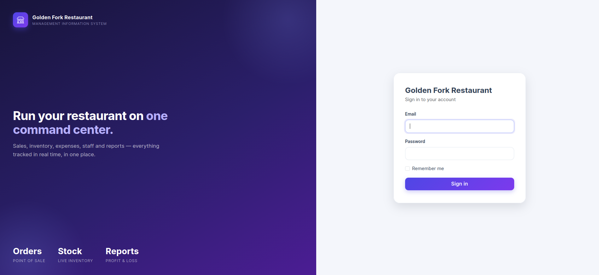

### Dashboard

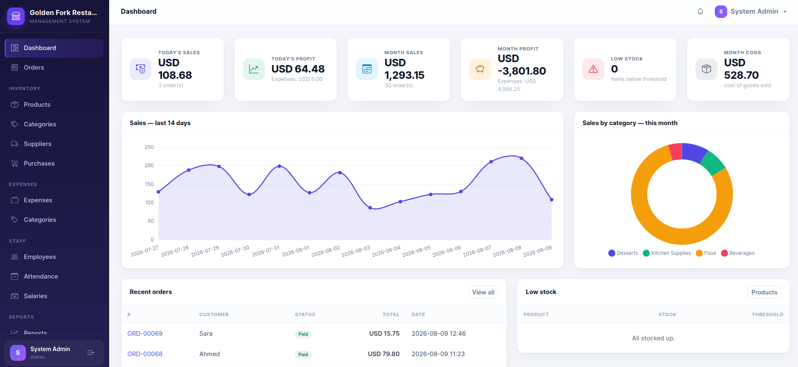

### Orders

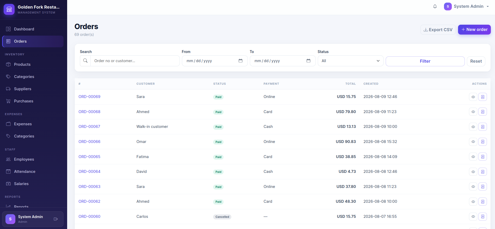

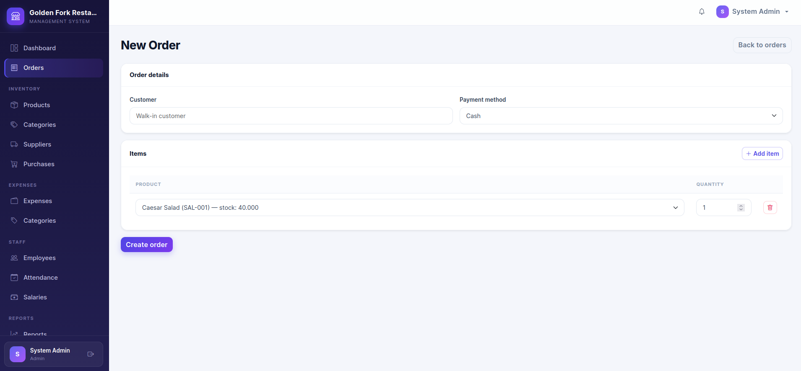

### Inventory

#### Products

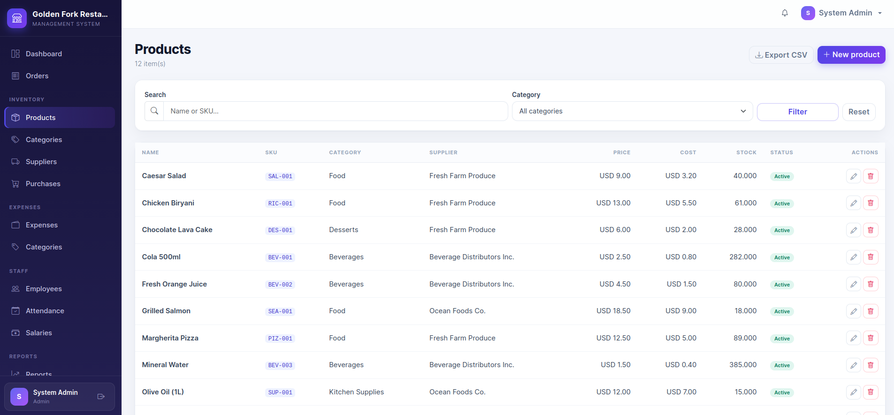

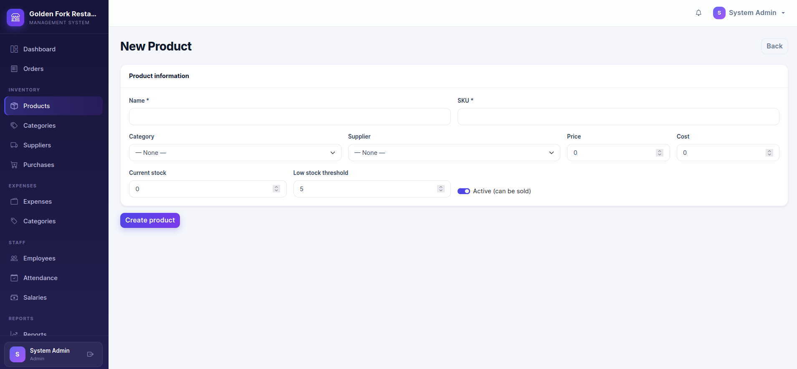

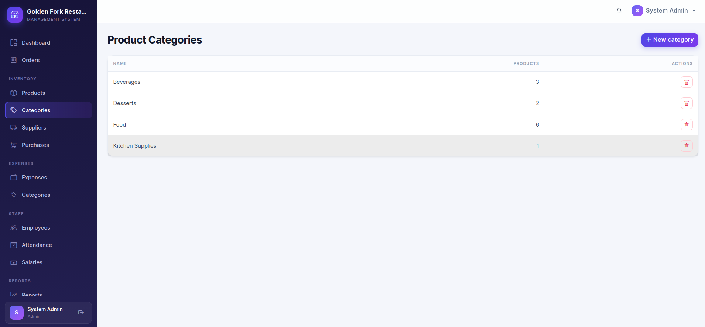

#### Purchases

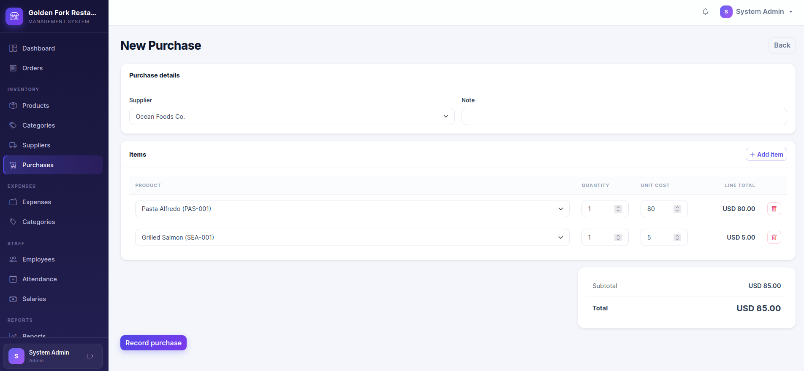

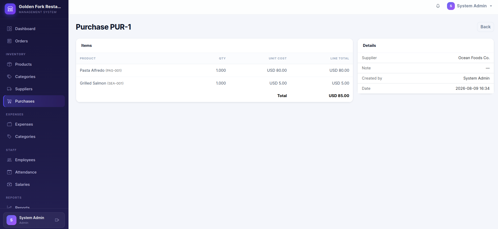

### Expenses

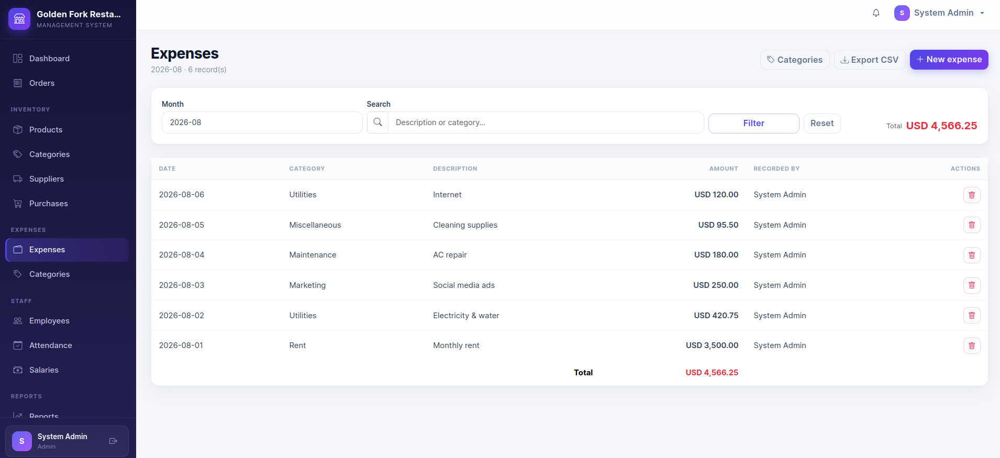

### Staff

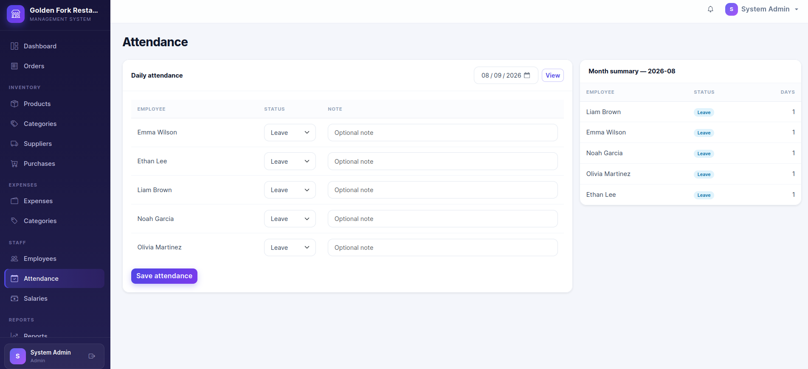

### Reports

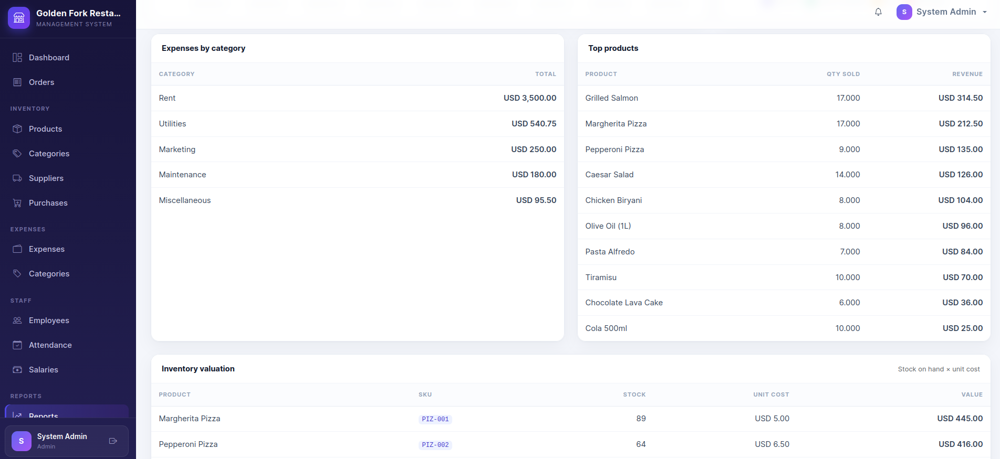

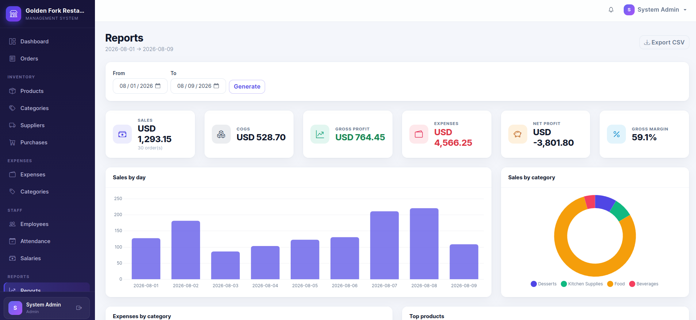

### Administration

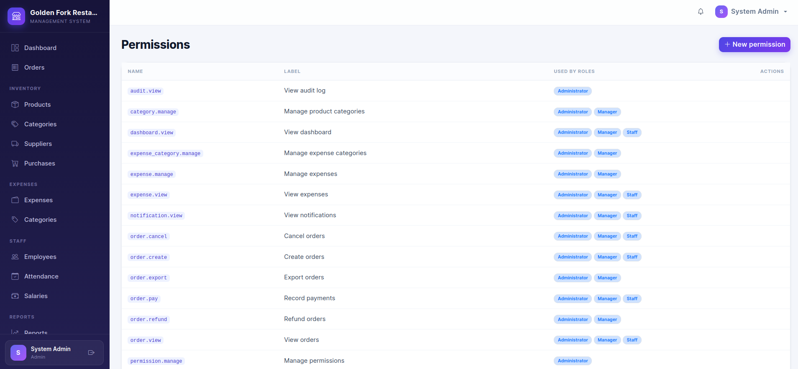

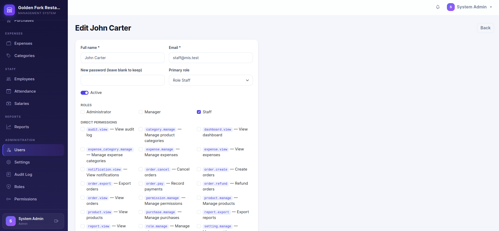
